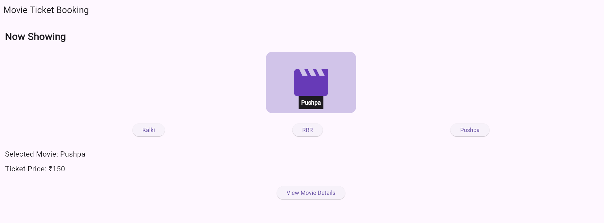
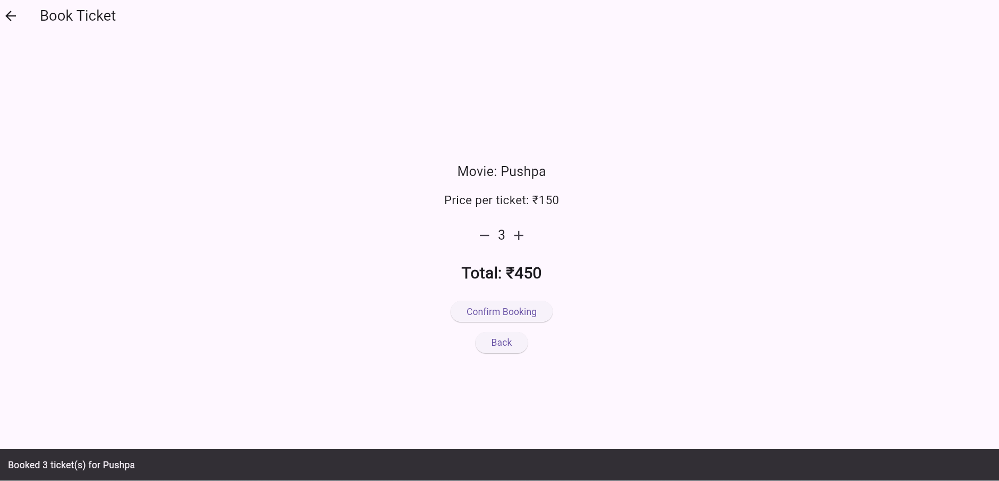
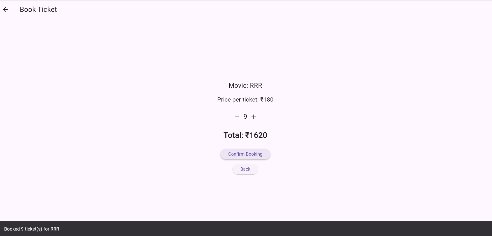

# 🎬 Movie Ticket Booking App

A simple **Movie Ticket Booking App** developed using **Flutter and Dart**.

This project is created to provide a simple and user-friendly interface for browsing movies and selecting movie tickets.

## 📱 About the Project

The Movie Ticket Booking App is a Flutter-based application that allows users to explore available movies and go through the movie ticket booking process.

The project is developed as part of an academic/project learning activity to understand Flutter widgets, layouts, navigation, and user interaction.

## ✨ Features

* 🎬 Display available movies
* 🖼️ Movie posters and movie information
* 🎟️ Movie ticket selection
* 💺 Seat selection
* 📅 Show/date selection
* 🏢 Cinema/theater selection
* 🧾 Booking details
* 📱 Simple and user-friendly interface
* 🔄 Navigation between different screens

> Note: Some features may be added or improved as the project develops.

## 🛠️ Technologies Used

* **Flutter**
* **Dart**
* **Visual Studio Code**
* **Git**
* **GitHub**

Flutter provides widgets and tools for building user interfaces and supports development for multiple platforms from a single codebase.

## 📂 Project Structure

```text
movie_ticket_booking_app/
│
├── android/
├── ios/
├── lib/
│   └── main.dart
├── web/
├── windows/
├── test/
├── pubspec.yaml
└── README.md
```

## 🚀 Getting Started

### 1. Clone the repository

```bash
git clone https://github.com/deepthinandanajg-create/movie_ticket_booking_app.git
```

### 2. Open the project

```bash
cd movie_ticket_booking_app
```

### 3. Get Flutter dependencies

```bash
flutter pub get
```

### 4. Run the application

For Chrome:

```bash
flutter run -d chrome
```

For Windows:

```bash
flutter run -d windows
```

## ▶️ Requirements

Before running the project, make sure you have:

* Flutter SDK installed
* Dart SDK
* Visual Studio Code or another Flutter-compatible IDE
* Chrome or Windows development environment

Flutter's official documentation provides the current setup and getting-started instructions.

## 🎯 Project Objective

The main objective of this project is to develop a simple movie ticket booking application while learning:

* Flutter widgets
* Dart programming
* UI design
* Screen navigation
* User interaction
* State management basics
* Git and GitHub

## 🔮 Future Enhancements

The following features can be added in future versions:

* User login and registration
* Firebase integration
* Online payment
* Booking history
* Movie search
* Movie categories
* Real-time movie data
* Push notifications
* Ticket cancellation

## 👩‍💻 Developer

**Deepthinandana Jonnalagadda**

## 📄 License

This project is created for educational purposes.
=====================================================================

Flutter widgets such as Text, Icon, Row, Column, and Stack are used to design the Movie Ticket Booking App interface. These widgets arrange movie names, prices, and selection buttons in a user-friendly layout.


The app uses MediaQuery and LayoutBuilder to create a responsive user interface that adjusts to different screen sizes. This helps the Movie Ticket Booking App display its content properly on mobile phones, tablets, and computers.


The Navigator and Named Routes are used to move between different screens in the Movie Ticket Booking App. Users can navigate from the home screen to movie details and booking screens, and return using the back button.

  

  


Stateful and Stateless widgets are used to manage the Movie Ticket Booking App interface. The app uses setState and Provider to update the selected movie, ticket price, number of tickets, and total booking cost dynamically.


Custom widgets and themes are used to improve the appearance of the Movie Ticket Booking App. Consistent colors, text styles, and reusable widgets display movie details, ticket prices, and booking information clearly.





The Movie Ticket Booking App displays movie names, details, and ticket prices using predefined data in Flutter. Users can select a movie and view its ticket price and booking information.

